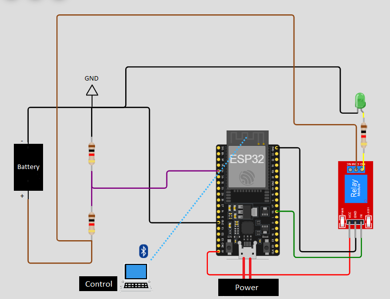
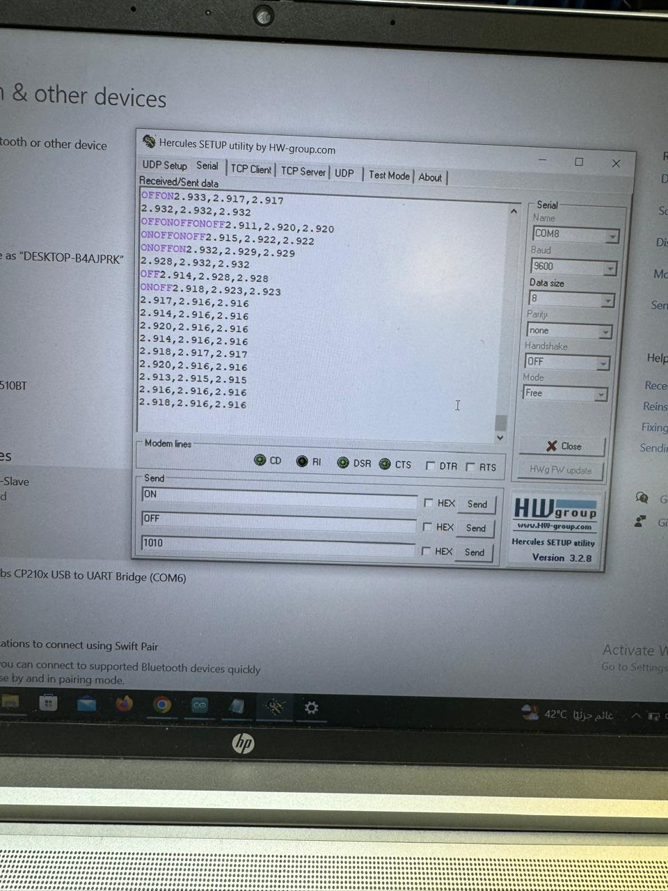
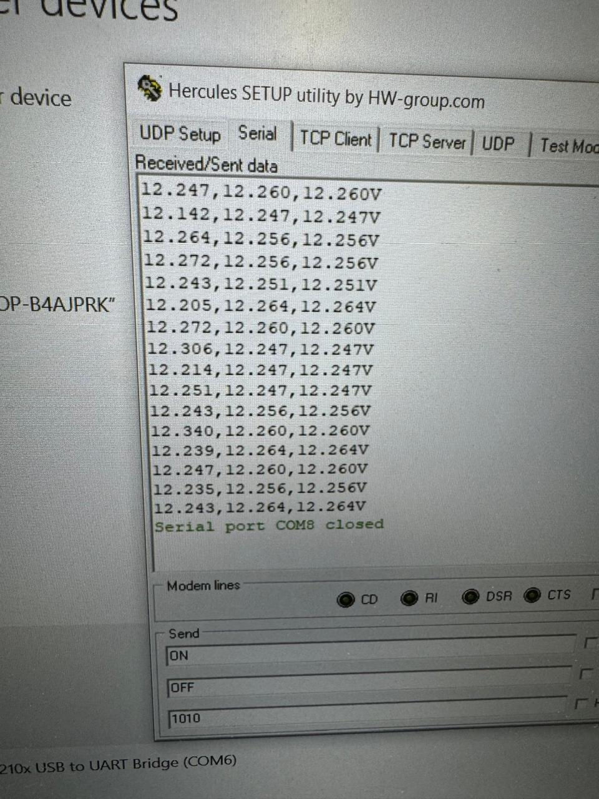
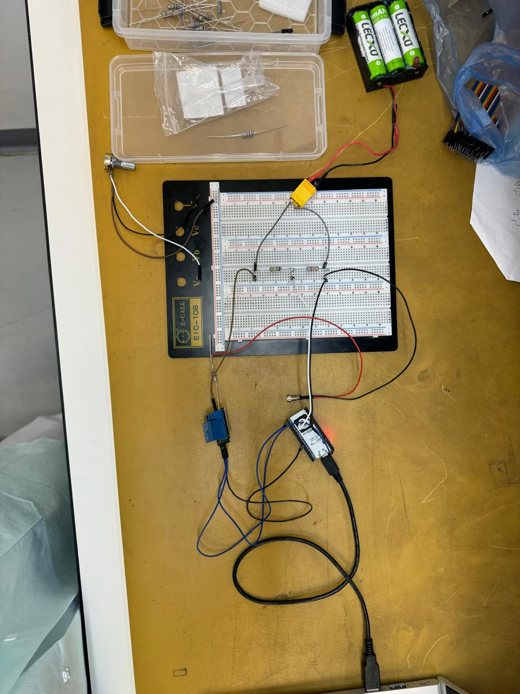
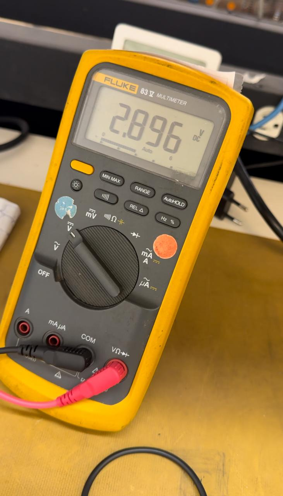
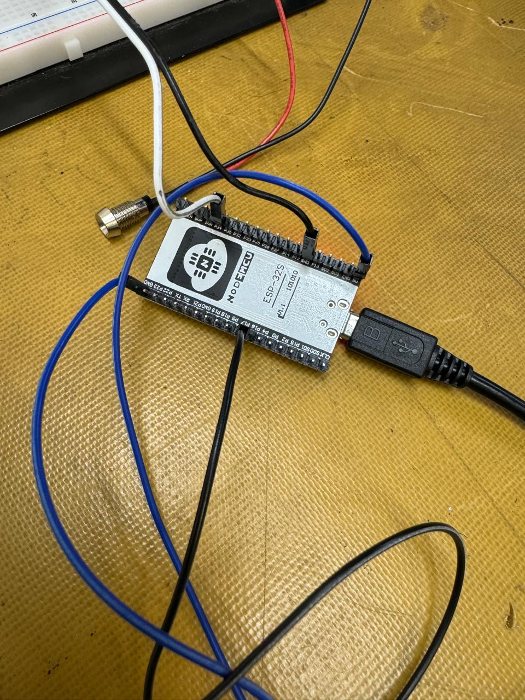
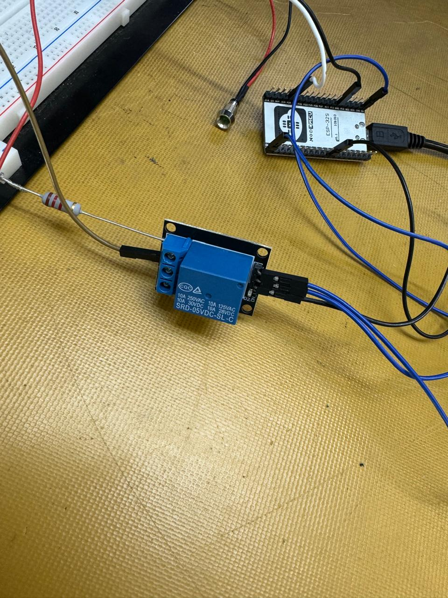
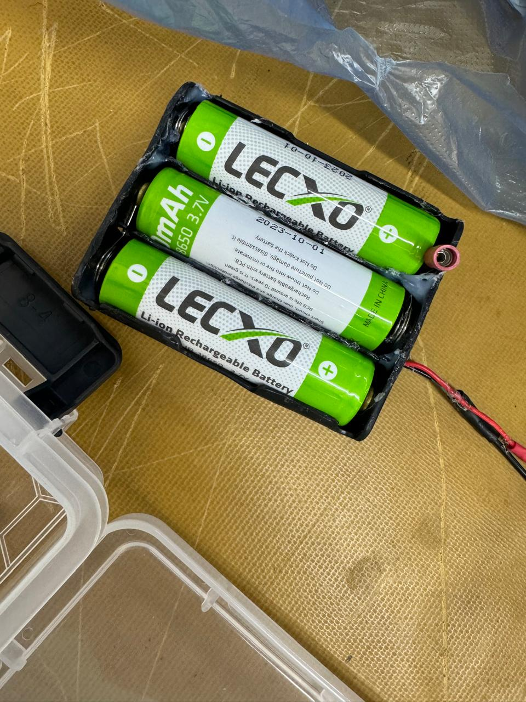
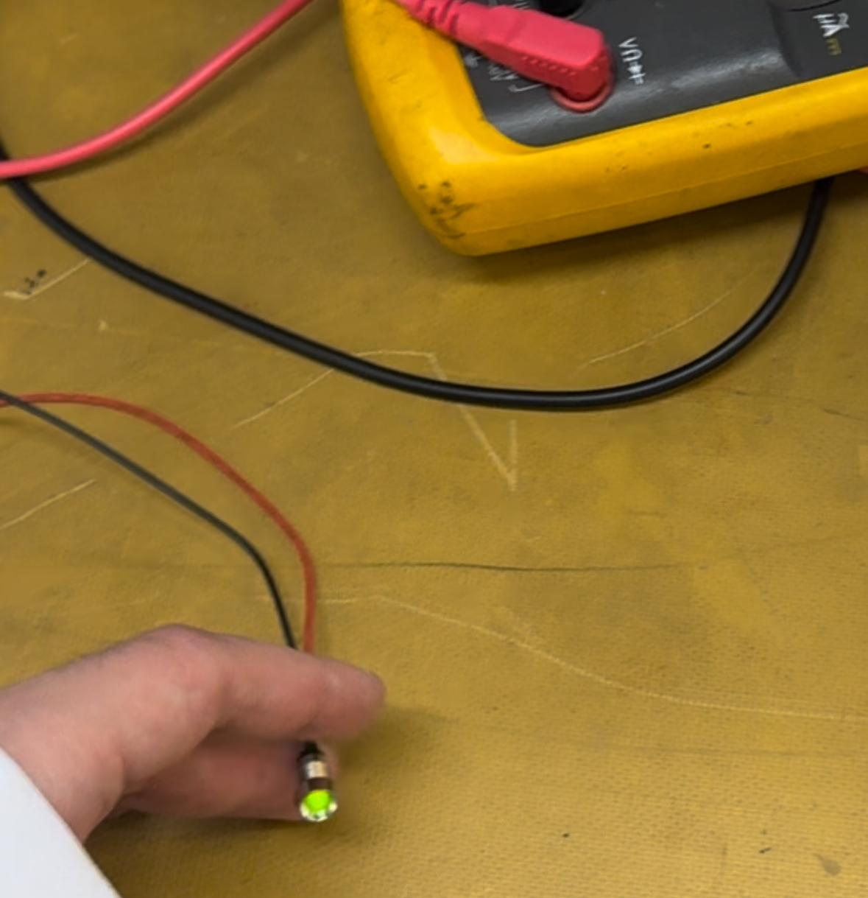

# ESP32 Bluetooth Relay Control & Battery Monitoring

An ESP32 prototype for switching a battery-powered load over Bluetooth while monitoring battery voltage. I combined wireless relay control, calibrated ADC conversion, sample averaging, and voltage-dependent correction factors in an Arduino sketch, then assembled and tested the circuit on a breadboard.

**Talal Aloushan · August 2024**

## Overview

A Bluetooth controller sends `ON` or `OFF` to the ESP32, which drives the relay and returns a confirmation. The ESP32 also sends battery-voltage readings to the controller and USB serial output.

## Results

The prototype demonstrates Bluetooth load control and voltage monitoring. After adding the 4.2 scaling factor, the terminal displays battery-voltage estimates around **12.25 V**.

| Voltage comparison | Value |
|---|---:|
| Representative ESP32 terminal reading | 2.916 V |
| Multimeter reading | 2.896 V |
| Difference | +0.020 V (20 mV) |
| Relative difference, using the multimeter as reference | **+0.69%** |

The earlier, unscaled comparison gives `(2.916 − 2.896) / 2.896 × 100 ≈ 0.69%`.

I attributed the lower multimeter reading to **meter loading**: connecting the meter makes it part of the circuit, and its finite input resistance can slightly lower the divider-output voltage. The exact loading contribution was not measured separately ([Fluke reference](https://assets.fluke.com/manuals/87______umeng0800.pdf)).

Both terminal captures show three unlabeled diagnostic values per line; their individual meanings are unconfirmed. The saved sketch prints one processed battery-voltage value per update to each output.

<strong>Prototype and test photos</strong>

| Before voltage scaling | After voltage scaling |
|:---:|:---:|
|  |  |
| **Breadboard prototype** | **Multimeter reading** |
|  |  |

## Components

| ESP32 controller | Relay module | Battery pack | Demonstration load |
|:---:|:---:|:---:|:---:|
|  |  |  |  |
| **ESP-32S** NodeMCU development board | **SRD-05VDC-SL-C** relay module | **3 × 3.7 V 18650 Li-ion cells** | **LED with series resistor** |

The three-cell pack is 11.1 V nominal and 12.6 V fully charged. A resistor divider, breadboard, and jumper wires complete the prototype.

The **LED is the demonstration load**; a suitable motor, pump, or lamp could replace it, with matching power and relay ratings and any necessary load protection.

## Approach

- **Wireless control:** Bluetooth Classic Serial Port Profile, advertised as `ESP32-BT-Slave`; `ON` sets GPIO16 high and `OFF` sets it low.
- **Voltage sensing:** The resistors reduce 12.6 V to 3.0 V at GPIO34, keeping the battery voltage off the ADC input. Software scales the processed reading back by **4.2**: 2.90 V at the divider corresponds to about 12.18 V at the battery. A multimeter shows the voltage at its probe locations.
- **Reading processing:** ADC calibration, a 30-sample moving average, and voltage-dependent correction factors process the measurement before battery scaling.
- **Feedback:** Command acknowledgements and voltage readings share the Bluetooth connection. Voltage is reported approximately once per second, with USB serial at 9600 baud.

## Project files

| File | Purpose |
|---|---|
| [`ESP32_BTH_RLY_ADC.ino`](ESP32_BTH_RLY_ADC.ino) | Relay control, Bluetooth communication, ADC conversion and filtering |
| [`Connections_new.png`](Connections_new.png) | Main connection diagram with Bluetooth control shown |
| [`images/`](images/) | Original hardware and bench-testing photos |
| [`ci.json`](ci.json) | ESP32 target exclusion configuration |
